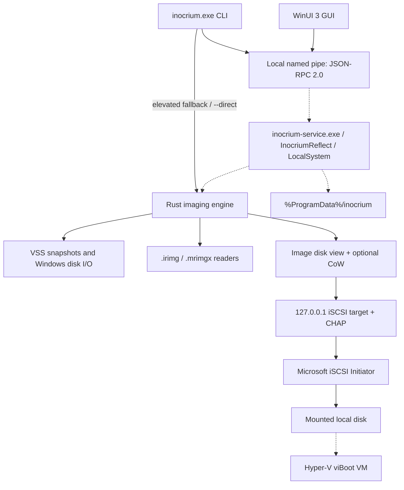

# inocrium reflect

An early-stage, GPL-3.0-only Windows disk-imaging project intended as an open-source alternative to Macrium Reflect. The core is written in Rust, with a WinUI 3 desktop application.

> **Early-stage software:** keep independent backups and test restores on disposable disks before relying on an image. Verification checks stored data integrity; it does not prove that a restored system will boot. Restore operations overwrite target data.

The imaging libraries, background service, GUI, CLI, WiX packaging and administrator test scenarios are implemented. Unit and non-elevated integration tests pass; the privileged paths (VSS, iSCSI mounts, restore to real disks, Hyper-V, the installed service and its scheduling/recovery lifecycle) have not yet been exercised end to end on an elevated system.

## Features

### Implemented in the core libraries

- **Full disk and selected-partition images.** Smart capture uses `FSCTL_GET_VOLUME_BITMAP` for NTFS and ReFS and excludes the extents of `pagefile.sys`, `hiberfil.sys` and `swapfile.sys` when those extents can be queried. It preserves boot-sector regions. Other file systems, or an unavailable allocation bitmap, fall back to forensic capture.
- **Forensic capture.** Reads every sector of selected partitions and includes unpartitioned disk gaps. All-zero blocks are omitted from storage and reconstructed as zeros.
- **VSS sources.** Supported NTFS/ReFS volumes are read through Volume Shadow Copy Service snapshots, including in forensic mode. Unsupported volumes and raw disk regions are read directly. A VSS creation failure aborts the backup rather than silently reading a supported volume live.
- **Native `.irimg` images.** Independently compressed zstd blocks, optional AES-256-GCM encryption with an Argon2id password KDF, BLAKE3 integrity checks, comments, and split files (`.irimg`, `.i01`, `.i02`, ...). The default block size is 1 MiB and default compression level is 3. See the [image-format reference](docs/image-format.md).
- **Image verification and VHDX export.** Native verification checks block hashes and, for encrypted images, authentication tags. Windows export creates a VHDX from an image disk.
- **Read-only or writable mounts.** Images are exposed through a loopback iSCSI target at `127.0.0.1` on an ephemeral port with random CHAP credentials. Writable mounts use temporary copy-on-write files; unmounting discards changes without modifying the source image.
- **Whole-disk and single-partition restore.** Whole-disk targets must be at least as large as the imaged disk. GPT structures are recomputed for larger targets; optional extension grows the last partition, with filesystem-extension failures reported as warnings. A partition can be restored into an existing partition of sufficient size or suitable free space on an initialized disk.
- **Retention.** Keep the last N full images or images younger than N days within a destination/prefix group. Retention removes all split parts of expired images and preserves checkpointed backups and the image just written.
- **Interrupted-backup primitives.** The engine writes `<image>.irimg.ckpt` checkpoints, can reopen an incomplete image, and can reuse a persistent VSS snapshot. Resume requires the same sources and an available original snapshot. The service resumes interrupted definition backups automatically (see below); direct CLI backups and one-off `backup.start` backups use nonpersistent snapshots and do not provide restart recovery.
- **ReDeploy helpers.** Offline storage-driver activation, optional driver injection with DISM, and boot-file repair with `bcdboot` for a restored Windows installation. These steps do not guarantee compatibility with every hardware configuration.
- **Hyper-V helpers for viBoot.** VM creation, start, stop and removal using a pass-through disk, with Generation 2 for GPT and Generation 1 for MBR. The caller must keep the backing disk mounted for the VM's lifetime.
- **Macrium Reflect X `.mrimgx` reading.** Read-only image access for verification, mounting, restore and VHDX export, including resolution of split files and supported incremental/differential chains in the same directory. This does not create Macrium images or promise compatibility with every Reflect format/version. Macrium block verification uses the format's MD5 checks, rather than native `.irimg` BLAKE3 checks.

### Service and applications

The WinUI 3 GUI has Disks, Backup definitions, Schedule, Existing images, Mounts, Activity/History with a log viewer, and Settings pages. It connects to the service over local JSON-RPC and reports service-unavailable errors when the service is not running.

The LocalSystem service implements all methods in [the IPC contract](crates/ipc/src/proto.rs), including:

- Daily/weekly/monthly schedules with optional missed-run catch-up (`runMissed`) and recovery of interrupted backups using checkpoints and retained persistent VSS snapshots.
- A job queue, cancellation, progress notifications, history and per-job logs.
- Mounts that outlive a GUI or CLI connection, with disposable writable overlays under `%ProgramData%\inocrium\cow`.
- viBoot orchestration that keeps a writable CoW iSCSI disk alive for a Hyper-V VM, choosing Gen2 for GPT and Gen1 for MBR.
- Saved definitions/settings, SMB UNC destinations, DPAPI-protected network and saved image passwords, and persisted VM records.

Behavior worth knowing:

- A definition backup that is cancelled or interrupted (service stop, reboot) keeps its checkpoint and persistent VSS snapshot. Running the definition again, its next schedule, or the next service start (for enabled definitions) resumes it. If the sources or the snapshot changed, the partial image is deleted and a new backup starts.
- Retention runs after a successful backup and is skipped while any image of that definition is mounted or in use.
- viBoot mounts the image writable without drive letters and attaches the disk to the VM; these mounts appear in `viboot.list`, not `mounts.list`, and are removed with `viboot.stop`.
- Stopping the service cancels jobs, removes viBoot VMs and unmounts everything. Startup removes VMs, iSCSI sessions and CoW files left by a crashed instance. CoW changes never survive a service restart or reboot.
- The service logs to `%ProgramData%\inocrium\logs\service.log` (`INOCRIUM_LOG` sets the `tracing` filter, default `info`); per-job logs sit next to it. For development, `inocrium-service.exe --console [--data-dir DIR]` runs it in an elevated console until Ctrl+C.

These lifecycle behaviors are covered by code review and non-elevated tests only.

## Quick start

### MSI and GUI

The WiX v5 MSI authoring in `installer/` installs the GUI, `inocrium.exe` and the LocalSystem service `inocrium-service.exe` under service name `InocriumReflect`. It registers automatic startup and service-failure restart, adds the CLI directory to the system PATH, and creates a Start-menu shortcut. Packaging source is present; a successful MSI build, installation and service startup have not been verified here.

After building the MSI, install with administrator rights, start the GUI, select the source disk/partitions on **Disks**, and create a backup definition with a destination. Use **Existing images** to inspect, verify, mount, restore or export an image. Configure schedules in **Backup definitions** / **Schedule** and network credentials in **Settings**. GUI restores require a selected target and the typed confirmation `RESTORE <disk number>`. Uninstall preserves `%ProgramData%\inocrium` definitions and configuration.

For development, build the GUI as described below and launch `Inocrium.App.exe`. It requests elevation and requires a separately installed/running service; it does not install the service itself.

### CLI

These examples follow [crates/cli/src/args.rs](crates/cli/src/args.rs) and its dispatch implementation. Run privileged disk operations from an elevated PowerShell. The CLI tries the service first; if connection fails, it falls back to in-process execution when elevated. `--direct` forces in-process execution, `--json` selects machine-readable output, and `--detach` returns a service job ID without waiting. Direct mode rejects `--detach`; a connected service's RPC failure does not trigger a direct retry.

```powershell
inocrium.exe disks

# Smart full image with compression and post-backup verification.
inocrium.exe backup --disk 1 --dest D:\Backups --prefix workstation --compress 3 --verify

# Selected partitions, encryption prompt, split files, comment and retention.
inocrium.exe backup --disk 1 --partitions 1,3 --dest D:\Backups --encrypt --split 4G --comment "Before upgrade" --keep-last 3

# Sector-by-sector capture; use --keep-days as an alternative to --keep-last.
inocrium.exe backup --disk 1 --dest D:\Backups --forensic --keep-days 30

inocrium.exe verify D:\Backups\workstation-20261014-090507.irimg
inocrium.exe mount D:\Backups\workstation-20261014-090507.irimg --partition 2
inocrium.exe mount D:\Backups\workstation-20261014-090507.irimg --writable
inocrium.exe unmount <id>
inocrium.exe unmount all
inocrium.exe export-vhdx D:\Backups\workstation-20261014-090507.irimg D:\Exports\workstation.vhdx
```

`<id>` denotes the returned mount ID; substitute it before running the command. `unmount` and `unmount all` manage service-owned mounts. A direct mount keeps the CLI process running until Ctrl+C and is cleaned up by that process; a separate direct `unmount` command cannot manage it. Writable-mount changes are temporary. Image disk selectors (`--disk` on mount, restore, export and viBoot) use image-local indices starting at 0; backup and target disk numbers refer to current Windows disk numbers.

**Destructive operations:** check the current disk numbers with `disks` and confirm the target before using these examples. A whole-disk restore erases its target; restoring to a smaller disk is unsupported. The running Windows disk cannot be a whole-disk restore target.

```powershell
inocrium.exe restore D:\Backups\workstation-20261014-090507.irimg --target-disk 2 --extend

# Restore image partition 3 into an existing partition at least as large.
inocrium.exe restore D:\Backups\workstation-20261014-090507.irimg --disk 0 --partition 3 --target-disk 2 --target-partition 4

# Create a partition in suitable free space; --target-offset is an optional byte offset.
inocrium.exe restore D:\Backups\workstation-20261014-090507.irimg --disk 0 --partition 3 --target-disk 2
inocrium.exe redeploy --disk 2 --drivers C:\Drivers
```

The CLI asks you to type the target disk number before restore; `--yes` bypasses that confirmation for automation. `--target-partition` and `--target-offset` require `--partition` and are mutually exclusive. Whole-disk targets smaller than the imaged disk are unsupported; a partition restore instead checks the selected partition's size.

Additional commands and schedule options are implemented in the parser and dispatch:

| Command | Options / behavior |
| --- | --- |
| `backup` | Repeat `--disk` for multiple disks; `--partitions 1,3` requires exactly one disk. Compression is 0..19 (default 3); split sizes accept bytes or integer K/M/G/T binary suffixes. `--keep-last` and `--keep-days` are mutually exclusive. |
| `viboot start ` | `--disk` (default 0), `--name`, `--memory` in MiB (default 4096), `--cpus` (default 2); requires service orchestration. |
| `viboot list`, `viboot stop <name>` | Service-owned VM lifecycle. |
| `def list`, `def run <id>`, `def delete <id>` | Saved definition management and execution. |
| `def create --name <name> --disk <number> --dest <folder>` | Backup options plus one of `--daily HH:MM`, `--weekly HH:MM --days mon,wed,fri`, or `--monthly HH:MM --day 1..31`; `--run-missed` enables catch-up. |
| `jobs`, `jobs cancel <id>` | List/cancel service jobs. |
| `history --limit <count>`, `logs <job-id>` | Service history (default limit 50) and per-job logs. |

Direct mode can save and manually run unencrypted definitions, but does not execute schedules. Creating encrypted definitions requires the service. viBoot, jobs, history and logs require the service. Use `inocrium.exe --help` or a command's `--help` for the complete syntax.

Passwords are entered at an echo-disabled prompt, supplied through the global `--password-stdin` flag, or read from `INOCRIUM_PASSWORD`; stdin takes precedence over the environment variable. Creating an encrypted backup/definition prompts for confirmation when no password was supplied. Passwords are never accepted as password-valued command-line arguments. JSON mode can emit multiple JSON records for progress, job IDs and results; diagnostics go to stderr.

For example, this definition is run by the service's scheduler:

```powershell
inocrium.exe def create --name "Nightly" --disk 1 --dest D:\Backups --verify --daily 02:00 --run-missed
```

## Non-goals

- Creating incremental or differential `.irimg` backups; native backups are full images. Reading an existing supported `.mrimgx` chain is a separate feature.
- WinPE rescue-media creation.
- Direct disk cloning.
- File-level backup.

## Architecture

The application architecture separates elevated imaging work from the desktop UI. The GUI and CLI share the typed IPC contract; core libraries also support in-process use. Dashed paths below are wired in the service but have not been exercised end to end on an elevated system.



The pipe is `\\.\pipe\inocrium-reflect`. The service data directory is `%ProgramData%\inocrium`, containing `definitions/*.json`, `cow/`, `logs/`, `settings.json`, `credentials.json`, `history.json` and `vms.json`. Service startup restricts this tree to SYSTEM and Administrators. See [architecture and IPC details](docs/architecture.md) for component boundaries, every RPC method and integration status.

## Security

- The IPC server defaults to a protected pipe ACL granting access to Administrators and SYSTEM, checks the connecting client's administrator membership, and rejects remote pipe clients. The GUI requests elevation to use this pipe.
- Image mounts bind their iSCSI target to loopback only, use an OS-assigned port and generate random CHAP credentials. This is a local mount mechanism; CHAP does not encrypt iSCSI traffic.
- Optional native image encryption covers data blocks and the manifest/raw-region/index metadata. File headers, footers and the checkpoint sidecar remain readable; the sidecar contains index and disk metadata. See [encryption details](docs/image-format.md#encryption) and [checkpoints](docs/image-format.md#splitting-and-checkpoints).
- Windows DPAPI and SMB helpers and service credential-persistence code are present. The store uses current-user DPAPI; when run as LocalSystem, secrets belong to that service identity. For UNC destinations and images it connects to the share without assigning a drive letter, using credentials configured in Settings.
- Service startup applies a protected, inheritable DACL to `%ProgramData%\inocrium` granting full control only to SYSTEM and Administrators; the CLI applies the same DACL when it creates the directory in direct mode. Image destinations also need appropriate access controls.
- Passwords and raw secret-bearing RPC parameters must never be logged. The local pipe carries plaintext JSON under its access controls; CHAP and image encryption do not protect that transport. CoW files hold decrypted scratch data and are not encrypted by the image password. Application-wide secret handling and installed ACL behavior still require integration validation.

## Building from source

Use Windows for the application and Windows-specific operations. Install Rust stable, the MSVC C++ build tools and a Windows SDK. The workspace declares `rust-version = "1.85"`; use current stable because the sources also use APIs newer than that declared minimum (for example, slice `as_chunks`).

```powershell
cargo build --release
```

The executable packages produce `target\release\inocrium.exe` and `target\release\inocrium-service.exe`; building them does not install a Windows service (use the MSI, or `--console` for development).

The GUI requires the .NET 8 SDK, Windows SDK and Windows App SDK/WinUI build tools. Its minimum Windows version is Windows 10 1809; Windows 11 is recommended for Mica. NuGet access is needed for the first restore.

```powershell
dotnet build gui/Inocrium.sln -p:Platform=x64
# Release output:
dotnet build gui/Inocrium.sln -c Release -p:Platform=x64
```

Release GUI output is under `gui\Inocrium.App\bin\x64\Release\net8.0-windows10.0.19041.0\win-x64\`. The normal build needs the .NET 8 Desktop Runtime; the Windows App SDK runtime is self-contained. See [gui/README.md](gui/README.md) for ARM64 and connection behavior.

The current project references MSIX BuildTools to supply portable PRI tasks. If your environment still fails with a missing `Microsoft.Build.Packaging.Pri.Tasks.dll`, install Visual Studio with the **Windows application development** workload and its Windows SDK/build tools, then rebuild.

MSI packaging uses the pinned WiX v5.0.2 SDK and UI/Util extensions, restored by .NET; a global WiX installation is unnecessary. Install the architecture's Rust MSVC target and run:

```powershell
rustup target add x86_64-pc-windows-msvc
.\installer\build.ps1
```

The script builds release Rust binaries, publishes a self-contained GUI, and builds `installer\out\x64\inocrium-reflect-0.1.0-x64.msi`. ARM64 is available with `-Platform ARM64` and the `aarch64-pc-windows-msvc` toolchain/libraries. See [installer/README.md](installer/README.md) for prerequisites and version options. Test installation on a clean Windows system before release.

## Testing

Run the Rust workspace tests from the repository root:

```powershell
cargo test --workspace
```

Tests needing elevated disk/VSS/iSCSI operations are marked `#[ignore]`. Inspect their prerequisites and use disposable test disks; run them from an elevated PowerShell:

```powershell
cargo test --workspace -- --ignored
```

The Pester runner requires Pester 5+, elevation and a built CLI. The existing VHDX scenarios cover GPT Smart capture and larger-target restore/extension, MBR forensic capture, encrypted split files, corruption detection, read-only/writable mounts, VHDX export, retention and partition-only restore:

```powershell
.\tests\Run-AdminTests.ps1
# Safe syntax-only validation without running administrator scenarios:
powershell.exe -NoProfile -File .\tests\Validate-Syntax.ps1
```

Read [tests/README.md](tests/README.md) for disposable-disk safeguards, prerequisites and cleanup. Unavailable mounts can be skipped; a successful test run with skips does not validate mounting. Some ignored Rust tests also need a prebuilt .NET IPC smoke project; inspect their prerequisites before running all ignored tests.

These are validation instructions, not a report that the suites passed. Passing library tests is not equivalent to successful live VSS capture, Microsoft iSCSI mounting, a physical restore or a Hyper-V boot. Test those workflows before depending on them.

## Repository layout

| Path | Responsibility |
| --- | --- |
| `crates/irimg/` | Native image format, block codecs, manifest/index, split files, checkpoints and verification. |
| `crates/winio/` | Windows disk/volume I/O, allocation maps, VHDX, privileges, DPAPI and SMB helpers. |
| `crates/vss/` | VSS requester, snapshot creation, lookup and cleanup. |
| `crates/blockdev/` | Block-device abstractions, image disk views, partition tables and CoW overlays. |
| `crates/iscsi/` | In-process iSCSI target, SCSI commands, CHAP and Windows initiator control. |
| `crates/mrimgx/` | Read-only Macrium Reflect X image and backup-set reader. |
| `crates/engine/` | Backup, verify, restore, retention, Windows sources, mounting and VHDX export. |
| `crates/redeploy/` | Offline Windows storage-driver and boot repair. |
| `crates/hyperv/` | Hyper-V pass-through VM lifecycle helpers. |
| `crates/ipc/` | Named-pipe JSON-RPC framing, transport, typed methods and notifications. |
| `crates/service/` | LocalSystem service: RPC handlers, job queue, scheduler, interrupted-backup recovery, persistent mounts, viBoot, persistence and ACLs. |
| `crates/cli/` | CLI parser, service dispatch, elevated direct operations, password input and progress/output. |
| `gui/` | WinUI 3 / .NET 8 desktop client. |
| `installer/` | WiX v5 MSI authoring and build/publish script. |
| `tests/` | Elevated Pester VHDX end-to-end suite, resource helpers and syntax validator. |
| `docs/` | Architecture and native image-format documentation. |

## License and trademarks

Licensed under **GPL-3.0-only**. See [LICENSE](LICENSE) for the full terms.

This project is not affiliated with Macrium Software. **Macrium Reflect** is a trademark of its owner.

Created in [T3 Code](https://t3.codes).
