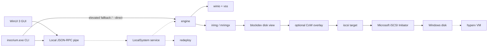

# Architecture

This describes the library boundaries and the application architecture. The service, GUI, CLI, IPC transport/contract, WiX authoring and test scenarios are implemented. Privileged behavior (VSS, iSCSI, restore, Hyper-V, the installed service lifecycle) has not been exercised end to end on an elevated system; statements below describe the implementation, not tested installed behavior. For user-facing status and commands, see the [README](../README.md).

## Application boundary

The service executable is `inocrium-service.exe`, installed as `InocriumReflect` and running as LocalSystem. It owns privileged operations, jobs, schedules, mounts and persisted state. The unpackaged WinUI 3 / .NET 8 GUI is an elevated RPC client; it does not install the service or perform imaging itself.

The CLI executable is `inocrium.exe`. Its dispatch tries the service first and falls back to in-process work when connection fails and the console is elevated. `--direct` forces in-process execution and `--json` selects JSON output. Once connected, a failed RPC is returned rather than retried directly. Service jobs are followed until completion unless `--detach` is used; direct mode rejects `--detach`. Password input uses an echo-disabled prompt, `--password-stdin` or `INOCRIUM_PASSWORD`, never password-valued command arguments.

Dashed edges are implemented but not yet exercised end to end on an elevated system. Read-only mounts can expose the disk view without a CoW overlay.

## Capture and storage

`winio` enumerates physical disks and partitions and exposes raw disks, volumes, allocation bitmaps, file extents and VHDX operations. `vss` creates and locates snapshot sets. `engine::win::prepare_backup` snapshots selected NTFS/ReFS volumes, retains raw disk access for partition tables and gaps, and computes allocated extents for Smart mode. Other filesystems use direct forensic reads. Failure to create a required VSS snapshot is an error; it is not a live-read fallback.

Smart capture subtracts discoverable extents of the Windows pagefile, hibernation file and swap file. The engine adds the first and last MiB of each partition and the region past the NTFS volume length reported by its boot sector to preserve boot metadata. It zeroes bytes outside selected extents within a stored block. Forensic capture reads every selected sector, with whole-disk gaps represented as additional streams. Both modes omit all-zero blocks; readers reconstruct holes as zeros.

The engine feeds parallel block encoders and a sequential `irimg` writer. The writer stores independent blocks and appends the compressed, optionally encrypted manifest/raw-region/index metadata and footer only when finished. A finalized image supports random reads through the index. See [image-format.md](image-format.md) for exact serialization.

Checkpoints are JSON sidecars named `<image>.irimg.ckpt`. They contain writer position/index/nonce state and engine/caller state; the writer stores no encryption keys or passwords. The VSS layer supports persistent snapshots and lookup by snapshot-set ID. Resume must use the original sources, matching capture plan and surviving snapshot; the service stores the definition id and snapshot-set id in caller state, keeps the snapshot after a cancelled or interrupted definition backup, requeues recoverable backups of enabled definitions at startup and releases snapshots after completion. An encrypted resume uses the definition's saved password. If the snapshot is gone or the sources changed, the partial image and checkpoint are deleted and a fresh backup starts. One-off `backup.start` backups use a nonpersistent snapshot and delete partial files on failure. This recovery lifecycle has not been tested on an elevated system.

Persistent snapshots currently use `VSS_CTX_CLIENT_ACCESSIBLE` without VSS writer coordination; nonpersistent backup snapshots use the writer-aware backup context. Persistent VSS therefore does not establish application-writer consistency. Unsupported filesystems, raw disk regions and the partition tail past a shadow device are read directly.

Direct CLI backups use nonpersistent snapshots, pass no recovery caller state and release snapshots when the operation ends. A leftover checkpoint alone does not make that path restart-resumable.

Retention selects native images by destination folder and filename prefix, using the first header's creation time. It preserves checkpointed images and the newly written image and deletes the consecutive split parts of expired images. Policies are keep-last-N or keep-N-days.

## Mount and viBoot lifecycle

`blockdev` provides a read-only disk view with partition tables and captured streams. Mounts use fresh disk identities to avoid collisions. Writable mounts wrap that view in a `CowOverlay`: writes copy up 64 KiB chunks to an append-backed scratch file, while untouched chunks are read from the image. The base image is never changed. Windows scratch files use delete-on-close; mount teardown also removes CoW paths.

`engine::win::MountManager` runs one iSCSI target per mount, binding to `127.0.0.1:0`, with random CHAP credentials and one LUN per selected image disk. It starts/uses the Microsoft iSCSI Initiator, adds a portal, logs in, discovers disks, and can assign drive letters. Teardown removes assigned letters, attempts volume dismount, logs out, removes the portal, stops the target and discards CoW files. Cleanup errors are reported; stale startup cleanup is best effort.

For `.irimg`, selecting one partition changes the exposed view. For `.mrimgx`, the current mount path still exposes the whole disk and limits the reported volumes to the selected partition.

The service design places overlays in `%ProgramData%\inocrium\cow`. `MountManager` itself accepts a caller-selected directory. The direct CLI uses that same path but owns its manager in the mounting process: it waits until Ctrl+C, then unmounts. A separate direct `unmount` cannot reach that manager.

`hyperv` implements pass-through VM creation and lifecycle through Hyper-V PowerShell cmdlets. Generation selection is Gen2 for GPT and Gen1 for MBR, and Secure Boot is disabled by default. The service's viBoot job creates a writable image mount without drive letters, creates and starts the VM on that disk, and records it in `vms.json`. `viboot.stop` removes the VM (bringing the disk back online) and then unmounts. Service stop removes all viBoot VMs; startup removes VMs recorded by a crashed instance before cleaning up stale iSCSI sessions. Backing mounts are hidden from `mounts.list` and refuse `mounts.unmount` with BUSY. A suitable Windows edition, enabled Hyper-V and its management cmdlets are required. VM boot and service cleanup have not been verified here.

Service-owned mounts outlive client disconnection and remain manageable through `mounts.list`/`mounts.unmount`. This does not promise that overlays or active sessions survive a service restart or reboot: the current CoW map is in memory, scratch files are delete-on-close and startup cleanup removes stale resources. Writable changes are discarded at unmount.

## Restore and ReDeploy

The Windows restore layer accepts either native or Macrium image disk views. A whole-disk restore rejects targets smaller than the source, incompatible sector sizes, the disk holding running Windows, and a target holding the source image. It locks/dismounts volumes and offlines the target during writes. GPT tables are rebuilt for the target size; identities can be changed to avoid collisions. Optional last-partition growth is separate from filesystem growth, which can fail and produce a warning.

Single-partition restore accepts an existing partition at least as large as the source or a suitable free-space range on an initialized disk. It checks target usage and size, writes captured data and updates partition metadata as needed. The CLI selects the image disk with `--disk` (default 0), the source partition with `--partition`, and the Windows destination disk with `--target-disk`. `--target-partition` selects an existing destination; otherwise free space is used, optionally at the byte offset given by `--target-offset`. CLI confirmation asks for the target disk number (`--yes` bypasses it); GUI confirmation uses `RESTORE <disk number>`. The service must independently enforce restore safety.

`redeploy` locates offline Windows installations, enables relevant storage-driver services in the offline SYSTEM hive, optionally installs drivers with DISM, and runs `bcdboot` when an appropriate system volume is available. Firmware choice follows the target partition style. Unsigned-driver injection requires an explicit option; dry-run support produces a plan without changing the hive. New-hardware boot success still requires a real boot test.

## IPC contract

The local pipe is `\\.\pipe\inocrium-reflect`. `ipc` implements JSON-RPC 2.0 with UTF-8 bodies framed as `Content-Length: <byte count>\r\n\r\n` followed by JSON. The application protocol version is 1, distinct from the JSON-RPC version. DTO keys and wire enums use camelCase; parameters are named JSON objects. The maximum body is 16 MiB and maximum framing header is 8192 bytes.

The source of truth is [crates/ipc/src/proto.rs](../crates/ipc/src/proto.rs). The service implements **all 30 methods** below (`crates/service/src/handler.rs`); `viboot.start` returns `Method not found` when Hyper-V is unavailable. Handler validation is unit-tested; privileged handlers are not yet tested on an elevated system.

| Area | Methods |
| --- | --- |
| Service | `service.info` |
| Disks | `disks.list` |
| Definitions | `definitions.list`, `definitions.get`, `definitions.save`, `definitions.delete`, `definitions.run` |
| Backup | `backup.start` |
| Jobs | `jobs.list`, `jobs.cancel` |
| Images | `images.list`, `images.inspect`, `images.verify`, `images.delete` |
| Mounts | `mounts.list`, `mounts.mount`, `mounts.unmount` |
| Restore/export | `restore.start`, `vhdx.export` |
| viBoot | `viboot.start`, `viboot.list`, `viboot.stop` |
| ReDeploy | `redeploy.start` |
| Settings | `settings.get`, `settings.set` |
| Credentials | `credentials.list`, `credentials.set`, `credentials.delete` |
| History/logs | `history.list`, `logs.read` |

Notifications are `job.progress`, `job.state`, `mounts.changed` and `definitions.changed`. The GUI uses StreamJsonRpc over `NamedPipeClientStream`, checks protocol version 1, reconnects every two seconds, and refreshes lists on reconnect. It never automatically retries a mutation.

## Jobs, schedules and recovery

Long operations (`backup.start`, `definitions.run`, `images.verify`, `restore.start`, `vhdx.export`, `redeploy.start` and `viboot.start`) return a job UUID. The service owns the queue and work independently of the requesting connection. The contract exposes `queued`, `running`, `succeeded`, `failed` and `cancelled` states, progress notifications and cancellation through `jobs.cancel`; history and per-job logs remain available through their RPC methods. The CLI follows a returned job unless detached, while the GUI shows Activity/History and logs. Backups, restores and ReDeploy run one at a time on a serial worker; verify, VHDX export and viBoot run concurrently. A definition cannot have two active jobs (BUSY). Request validation, password and not-found errors are returned by the starting call before a job is queued. Cancellation during privileged operations remains subject to elevated integration testing.

Definitions contain schedule, enabled status, `runMissed`, `lastRun` and `nextRun`. Schedule helpers calculate daily, selected-weekday weekly and monthly occurrences in local time. Wire weekdays use 0 = Sunday through 6 = Saturday; the CLI accepts names such as `mon,wed,fri`. A monthly day beyond the month's length clamps to month end. The current helper selects the first occurrence of ambiguous local times and tries one hour later for a nonexistent time.

Persistence stores a schedule anchor, so occurrences at or before that anchor do not fire again; new/changed schedules reset it. The scheduler thread re-evaluates definitions every 15 seconds and whenever definitions change. An occurrence noticed within five minutes runs; an older missed occurrence runs only when `runMissed` is enabled and is otherwise skipped (the anchor advances). A definition with an active job is not queued again. Interrupted backups are resumed through the normal backup job, which finds the checkpoint itself. Scheduler decisions are unit-tested; the installed lifecycle is not.

The CLI can save and manually run unencrypted definitions directly, but has no background scheduler. Encrypted definition creation, viBoot, jobs, history and logs require the service.

## State and security

The service's paths helper defines `%ProgramData%\inocrium` as the data root:

| Path | Intended contents |
| --- | --- |
| `definitions/*.json` | Saved backup definitions and schedules. |
| `cow/` | Disposable writable-mount and viBoot overlays. |
| `logs/` | Operation logs. |
| `settings.json` | Service settings. |
| `credentials.json` | DPAPI-protected network credential records. |
| `history.json` | Operation history. |
| `vms.json` | Service-managed viBoot VM records. |

Persistence and directory provisioning helpers are present. `Paths::create(true)` replaces the root DACL with protected SDDL `D:P(A;OICI;FA;;;SY)(A;OICI;FA;;;BA)`, granting full control to SYSTEM and Administrators and inheritance to children. Service startup calls that helper, and the CLI applies the same SDDL when it creates the directory in direct mode. Installed ACL behavior is untested here.

The store keeps definition image passwords and share passwords as hexadecimal DPAPI blobs, not plaintext JSON. DPAPI helpers support current-user or local-machine protection with fixed application entropy and no UI; the current store selects current-user scope. Under the LocalSystem service, this means the LocalSystem identity on that machine, not the interactive user's identity. Share records normalize the `\\server\share` key and expose only target/user through `credentials.list`. The service connects UNC destinations and image paths using those credentials and the SMB helper without assigning a drive letter. Do not assume interactive mapped drives or credentials are visible to LocalSystem.

The implemented IPC defaults use protected SDDL `D:P(A;;GA;;;BA)(A;;GA;;;SY)`, reject remote clients and check administrator membership under temporary client impersonation. Handlers run after reverting impersonation. Pipe frames carry secrets in plaintext locally, so access control and avoiding raw RPC logging matter. Passwords and raw secret-bearing parameters must not be logged. The CLI's implemented password input restores console echo after prompting; `--password-stdin` takes precedence over `INOCRIUM_PASSWORD`.

CHAP is one-way MD5 authentication with fresh challenges, not transport encryption. The generated username is `inocrium` with a random 16-character printable ASCII secret. Mount callers bind to loopback; the general `iscsi` crate allows a configurable bind address and is not intrinsically restricted to loopback. The image format's AES-GCM protection applies to stored image content, not CoW scratch files or checkpoint sidecars. Treat scratch data and checkpoint metadata as sensitive data protected by appropriate directory ACLs.
